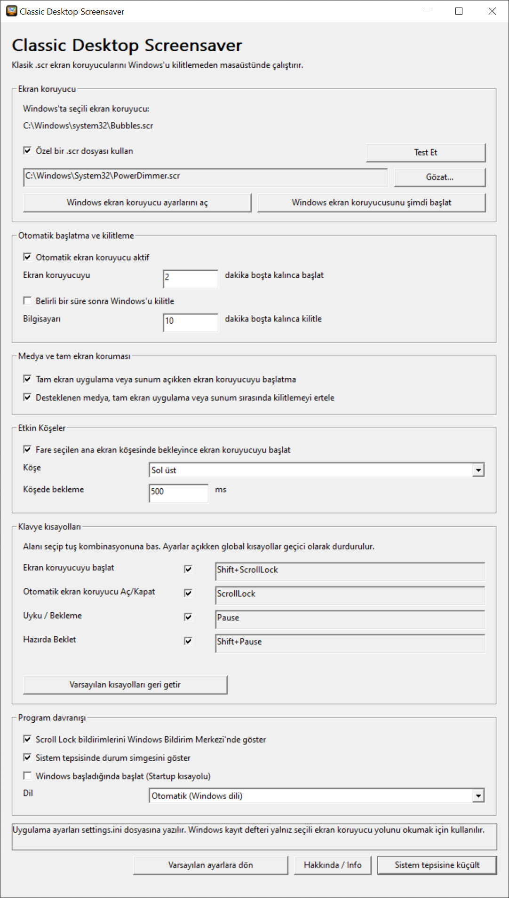
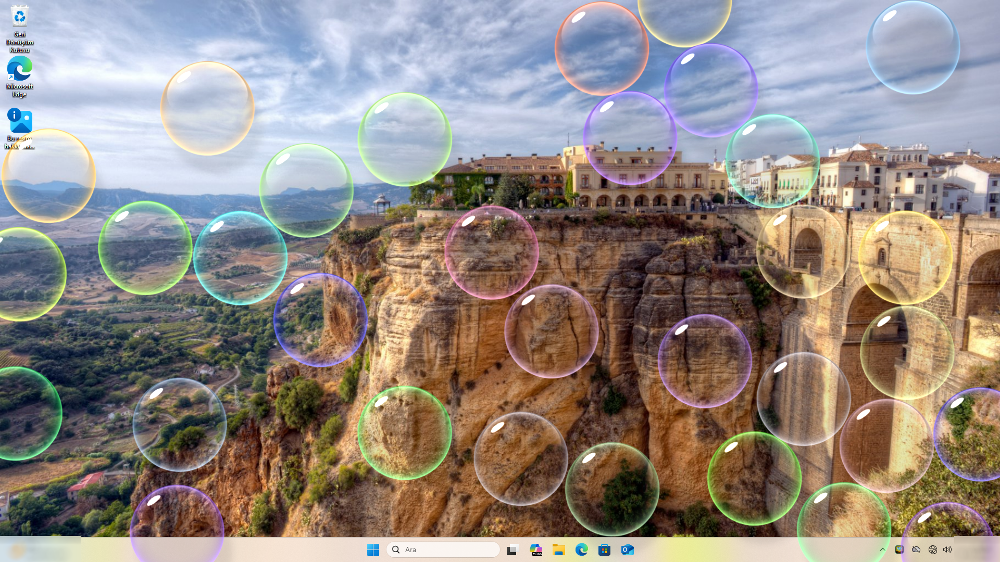

# Classic Desktop Screensaver

Classic Desktop Screensaver is a small native Windows utility that runs the
screen saver selected in Windows, or a custom .scr file, using its own idle
timer. It can start a screen saver without automatically locking the session.

The current release is a native C++20 / Win32 x64 application. It does not need
.NET, a service, a driver, administrator rights, or an installer to run.
This release is version **2.0.0**.

## Screenshots

### Application Settings

### Desktop Screensaver in Action

## Tested Windows versions

Tested on Windows 10 22H2 and Windows 11 26H2. Earlier Windows versions have not been tested.

Windows 11 26H2 testing included computers that support S0 Modern Standby and
computers that support classic S3 Sleep. Available states depend on the
computer's firmware, ACPI implementation, and Windows configuration; they do
not depend on the computer's age alone.

## Features

- Runs the Windows-selected screen saver or an optional custom .scr file.
- Starts the screen saver after an independently configured idle interval.
- Optionally locks Windows after a separate idle interval.
- Provides primary-display Hot Corners.
- Protects against starting the screen saver during full-screen applications
  and presentations.
- Provides configurable keyboard shortcuts and system-tray controls.
- Can start with the current user through a Startup-folder shortcut.
- Provides Turkish and English user interfaces.

The app does not reliably detect video playing inside every browser or media
player window. Windowed-video detection is not supported. The full-screen and
presentation guards remain available.

## Power states

The Sleep shortcut follows the sleep state Windows reports as available.
Hibernate is a separate action.

| Code | Windows power state | English term | Türkçe |
|---|---|---|---|
| S0 Low Power Idle | Modern Standby | Modern Standby / Sleep | Modern Bekleme / Uyku |
| S3 | Classic sleep | Sleep | Uyku |
| S4 | Hibernate | Hibernate | Hazırda Beklet |

- On an S0 Modern Standby computer, Pause requests the Windows display-off /
  Modern Standby workflow. The request is not a direct guarantee that Windows
  will enter S0 Sleep; Windows power policy decides whether and when that
  transition occurs.
- On a computer that supports classic S3 Sleep instead, Pause requests S3
  through the Windows sleep API.
- Shift + Pause requests S4 Hibernate only when Windows reports both S4
  support and an available hibernation file.
- The app does not emulate unsupported states. It does not convert a failed or
  unavailable S0/S3 request into Hibernate, and it does not convert Hibernate
  into Sleep or Shutdown.
- powercfg /a shows the sleep states available on the current computer.
  Modern computers may not offer S3; its absence is not by itself an app error.

S0, S3, and S4 are distinct states. The actual set of available states depends
on BIOS/UEFI, ACPI, and Windows configuration.

## Default keyboard shortcuts

The shortcuts below are assigned by default but **disabled until enabled in
Settings**. Each shortcut has its own enable switch, and users can change the
key combination.

| Shortcut | Action |
|---|---|
| Scroll Lock | Toggle automatic screen saver |
| Shift + Scroll Lock | Start the screen saver |
| Pause | Sleep using the available S0 or S3 path; except in recognized terminal windows, where the bare physical Pause is passed through |
| Shift + Pause | Hibernate (S4) |

The Pause key is intentionally reserved for its native function in terminal windows, where it may be used to pause running processes. Classic Desktop Screensaver does not override this behavior.

Pause tuşunun terminal pencerelerindeki doğal işlevi özellikle korunmuştur. Bu tuş, terminalde çalışan işlemleri duraklatmak için kullanılabildiğinden, Classic Desktop Screensaver bu işlevi engellemez.

The terminal exception applies only to the physical, unmodified Pause key.
The current implementation recognizes the classic Console Host window class
used by CMD and Windows PowerShell, and the Windows Terminal window class.
Third-party and IDE-integrated terminals may use other window classes and have
not all been verified. In those terminals, test the behavior before enabling
Pause as a Sleep shortcut.

## Screen saver and locking behavior

The automatic screen saver uses Windows user-input activity and its own
configured idle time. Windows locking has a separate timer and does not depend
on the app screen saver being enabled.

When Classic Desktop Screensaver runs normally, it temporarily prevents the
Windows-selected screen saver from competing with the app's own screen saver.
It does not write that runtime change to the user profile and restores the
previous state during normal exit or Windows session end. Password-protected
and recognized policy-managed screen savers are left alone. Close the app with
the tray menu's **Exit** command. A crash or forced process termination can
bypass cleanup and may leave the Windows screen saver disabled for the current
logon session.

## Running the application

- Run **ClassicDesktopScreensaver.exe** normally to open the main Settings
  window.
- Run it with **--background** to start in the system tray without opening
  Settings. The current user's Startup shortcut uses this mode.
- The app is single-instance. Starting it again opens Settings in the existing
  instance.
- Closing the Settings window minimizes the app to the tray. Use the tray
  menu's **Exit** command to close it.

## Portable use

Extract the Windows x64 package to a folder and keep **settings.ini** beside
**ClassicDesktopScreensaver.exe**. The file is editable and contains per-user
application settings. The release archive includes a default settings file.
The app can also run without an existing settings.ini; it uses defaults until
the user saves a setting.

## Setup

Run **Setup.cmd** and select one of the following:

1. **Install** copies the app to the current user's
   **%AppData%\Classic Desktop Screensaver** folder and creates a Start Menu
   shortcut. It does not start the app.
2. **Install and Run** performs the same installation and opens the main
   Settings window.
3. **Uninstall** closes the running app through its normal exit path, then
   removes the app folder, settings file, and shortcuts.
4. **Exit** closes Setup without changes.

Setup does not require administrator privileges and installs only for the
current Windows user. Install preserves an existing settings.ini; Uninstall
removes the settings stored in the installation folder. Back up that file
before uninstalling if you want to keep those preferences.

The **Start with Windows** option creates or removes a shortcut in the current
user's Startup folder. It launches the app with **--background**; no Registry
Run entry, service, or driver is added.

## Language

Automatic language selection follows the current Windows user's UI language:
Turkish Windows UI uses Turkish, and other languages use English. Turkish and
English can also be selected manually in Settings.

## Build from source

Use Visual Studio 2022 Build Tools with the MSVC v143 x64 toolchain and Windows
SDK 10.0.26100 or newer:

- **Build-Native.cmd** builds the x64 application and safe regression tests.
- **Build-Release.cmd** builds the native application, runs the regression
  tests, and creates a versioned x64 ZIP package.

The Release binary uses the static MSVC runtime and depends only on Windows
system DLLs. It has no .NET Runtime dependency.
